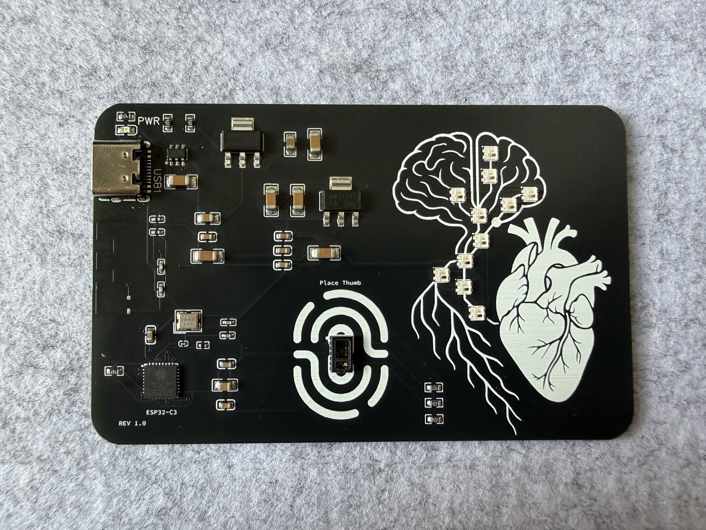
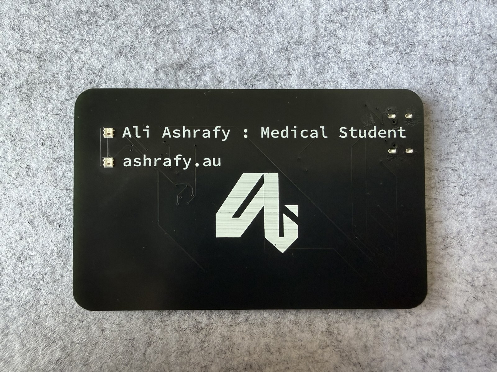
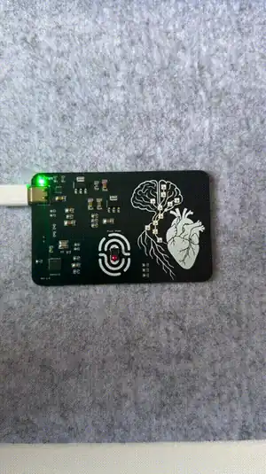

# CARDio: a heart-rate monitor business card

<p align="center">
  
  
</p>

**CARDio** is a PCB business card with a built-in heart-rate monitor. Put your thumb on the sensor and a nervous system drawn in silkscreen lights up in time with your heartbeat, coloured by your heart rate. Lift your thumb and it counts your BPM out on the LEDs.

<p align="center">
  
</p>

- **ESP32-C3** (RISC-V, Wi-Fi + BLE) with native USB: one USB-C cable powers and programs it.
- **MAX30102** optical pulse sensor under the "Place Thumb" pad.
- **13 addressable RGB LEDs**: 11 along the brain, spinal cord and nerve roots, and 2 on the back as bullet points for the name and URL.
- Credit-card sized, 4-layer, black and white. Designed in EasyEDA, now also a **KiCad 10** project.

## Using it

1. **Plug it in** with a USB-C cable (any phone charger or computer). A spark climbs the spinal cord, the brain lights up, and the card gives its first heartbeat.
2. **Idle:** the tree glows softly like starlight.
3. **Rest your thumb** lightly on the "Place Thumb" pad and keep still. A violet scan sweeps upward while it finds your pulse. After 5 to 10 seconds, each real heartbeat sends a wave up the tree. The colour tells you the rate:
   - **Blue:** under 60
   - **Teal/green:** resting
   - **Amber:** around 100
   - **Red:** 130+
4. **Lift your thumb** to see your number, counted out from the bottom up one digit at a time. For 72 bpm, 7 lights come on, then a pause, then 2 white lights. A zero shows as one soft flash of the whole tree.

If it doesn't find your pulse, press more lightly and hold still. Warm hands work better than cold ones.

## Repository layout

| | |
| --- | --- |
| [`firmware/`](firmware/) | The firmware (PlatformIO, Arduino on ESP32-C3): heart-rate detection, LED animations, and the boot-pin workaround. [Details →](firmware/README.md) |
| [`hardware/`](hardware/) | KiCad project, original EasyEDA sources, Gerbers/BOM/CPL for ordering, pin map, LED map and errata. [Details →](hardware/README.md) |
| [`docs/images/`](docs/images/) | Photos and renders |
| [`legacy/`](legacy/) | Early Arduino sketches from bring-up, kept for reference |

## Flashing the firmware

Install [PlatformIO](https://platformio.org/) (the VS Code extension or the CLI), plug the card in, then:

```bash
cd firmware
pio run -t upload
```

That's it: no buttons, no adapters. The ESP32-C3 programs over its own USB port. `pio device monitor` opens a serial console. Type `help` for commands, such as `status`, a live `plot` of the sensor signal, or `demo 72` to show off the LEDs without a thumb.

## Why?

I had tinkered with the idea of PCB business cards in the past. My first iteration was essentially just a blank PCB with a silkscreen. It did have circuitry for an ATtiny85 and some NeoPixels, though I never got it to work properly. I liked the idea of handing a business card to somebody that wouldn't be thrown away: one that would actually have a use, like an NFC tag, flashing lights, or an ECG. Perhaps this was a little overkill, but I wanted something to hand to medical professionals or surgeons at conferences that would leave a memorable impression. It also demonstrates my interest in combining medicine and technology, in this case embedded electronics.

## How it works

This was my first PCB that actually does something, so it's not very complicated. USB-C powers the board through two LDOs: one for 3.3 V (the ESP32-C3 and the LEDs) and one for 1.8 V (the MAX30102 sensor). Most of the passive components are the boilerplate to get the microcontroller running. The MAX30102 talks to the ESP32-C3 over I²C, and the RGB LEDs share a single data wire, daisy-chained together. The ESP32-C3 has a built-in USB programmer, so it doesn't need any extra circuitry for that.

The firmware shines infrared light into your thumb and watches how much comes back. Each heartbeat pushes a little more blood into the thumb, which absorbs a little more light, so the signal dips once per beat. It filters that signal, picks out each beat, rejects anything that doesn't fit a steady rhythm, and only shows a heart rate once it has five consistent beats in a row. The [firmware README](firmware/README.md#how-the-heart-rate-is-measured) has the details.

### The one thing that went wrong

Everything worked on the first batch, except for one mistake: the sensor's I²C lines are wired to the ESP32-C3's **boot-mode strapping pins** (GPIO8/9). If the chip resets in the middle of talking to the sensor, it can boot into its bootloader instead of the program, and the card looks dead until you unplug it. The current firmware works around this completely, and the [hardware notes](hardware/README.md#errata-and-ideas-for-rev-31) list it with the other fixes for the next revision.

### Why "Rev 3.0"?

My previous designs were:

- **Rev 1.0:** a simple blank board with a layout for an ATtiny to control LEDs (non-functional)
- **Rev 2.0:** a PCB business card that runs Linux using Onion Omega2 SBCs (not completed)
- **Rev 3.0 (this one):** a PCB business card that measures your heart rate (complete)

## Ideas for Rev 3.1

- Battery (coin cell) and maybe charging
- A small 0.91" OLED for the ECG trace and numbers
- More sensors
- The hardware fixes in the [errata](hardware/README.md#errata-and-ideas-for-rev-31): I²C off the strap pins, a ground plane, and an EN reset capacitor

## License

[MIT](LICENSE), covering the firmware, tools and hardware design files. Build your own, remix it, put your own name on the back.
