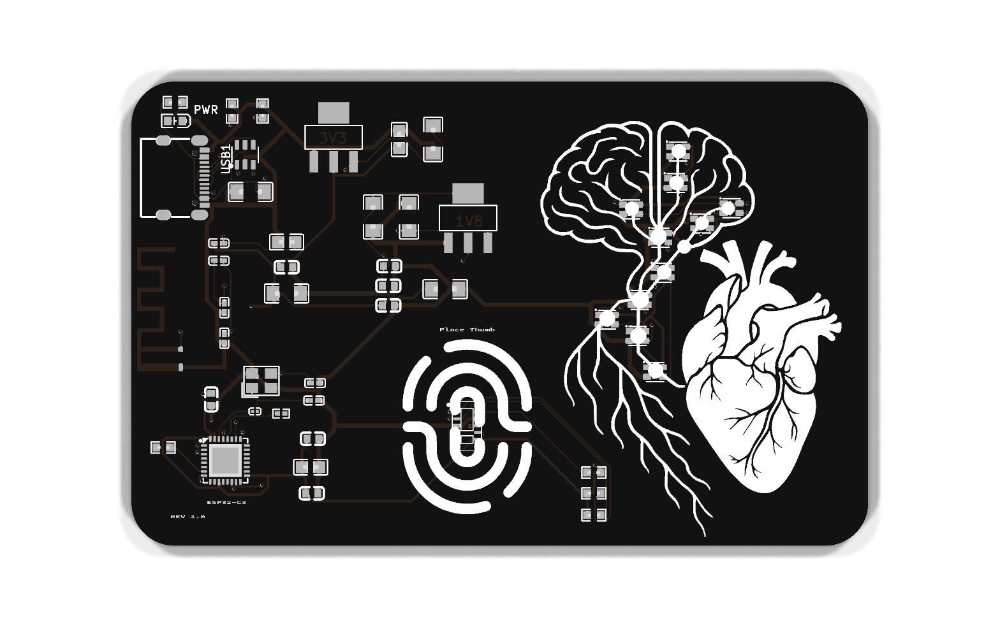
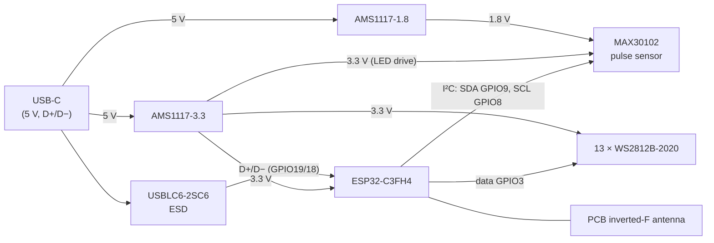

# CARDio hardware (Rev 3.0)

<p align="center">
  
  
</p>

A credit-card-sized PCB: an ESP32-C3 reads a MAX30102 pulse sensor under your thumb and drives 13 RGB LEDs, 11 of them laid out along a brain, spinal cord and nerve roots drawn in silkscreen. Power and programming are both over USB-C.

| | |
| --- | --- |
| Size | 85.85 × 54.23 mm (credit card), 1.6 mm, 4 copper layers |
| Finish | Black solder mask, white silkscreen, HASL |
| MCU | ESP32-C3FH4: RISC-V, Wi-Fi + BLE, 4 MB embedded flash, 40 MHz crystal |
| Sensor | MAX30102 pulse oximetry / heart-rate sensor (I²C) |
| LEDs | 13 × WS2812B-2020 addressable RGB (11 front, 2 back) + green power LED |
| USB | USB-C, power + the C3's native USB-Serial/JTAG (no USB-UART chip), USBLC6-2SC6 ESD protection |
| Power | 5 V USB → AMS1117-3.3 (MCU, LEDs, sensor LEDs) and AMS1117-1.8 (sensor core) |
| Antenna | On-board inverted-F PCB antenna (ANT1) |

## Files

| Folder | What's in it |
| --- | --- |
| [`kicad/`](kicad/) | **The KiCad 10 project**: schematic, PCB, design rules. Start here to modify the board. |
| [`fabrication/`](fabrication/) | What the cards were made from: Gerbers + drill (`CARDio_Rev3.0_gerbers.zip`), BOM and pick-and-place (CPL) for JLCPCB assembly. |
| [`easyeda/`](easyeda/) | The original EasyEDA Standard sources the board was designed in (open them via *File → Open → EasyEDA…* in EasyEDA). |
| [`tools/`](tools/) | The scripts used to convert the board to KiCad and to verify the conversion. |

## Block diagram



## ESP32-C3 pin map

| GPIO | Net | Used for |
| --- | --- | --- |
| 3 | `GPIO3` | WS2812B chain data in (to LED9) |
| 8 | `SCL` | MAX30102 I²C clock, 4.7 kΩ pull-up (R3). **Boot strapping pin**, see errata. |
| 9 | `SDA` | MAX30102 I²C data, 4.7 kΩ pull-up (R4). **BOOT strapping pin**, see errata. |
| 18 / 19 | `USB-D−` / `USB-D+` | Native USB (programming + serial console) |
| 20 / 21 | `U0RXD` / `U0TXD` | UART0, labelled but not broken out (TX through R1, 499 Ω) |
| 0, 1, 2, 4–7, 10 | `GPIOx` | Unused (net labels only) |
| EN | | 5.1 kΩ pull-up (R7) |

The MAX30102's `INT#` pin has a pull-up (R2) but isn't connected to the ESP32, so firmware has to poll the sensor.

## LED chain

The data line goes `GPIO3 → LED9 → LED10 → LED3 → LED1 → LED2 → LED4 → LED6 → LED5 → LED7 → LED8 → LED12 → LED13 → LED14`. LED11 is the PWR indicator, not part of the chain.

| Chain index | Ref | Where |
| --- | --- | --- |
| 0 | LED9 | Brain, top centre |
| 1 | LED10 | Brain, centre |
| 2 | LED3 | Brainstem junction |
| 3 | LED1 | Spinal cord |
| 4 | LED2 | Spinal cord, lower |
| 5 | LED4 | Base of the cord |
| 6 | LED6 | Spinal cord, upper |
| 7 | LED5 | Right lobe, inner |
| 8 | LED7 | Right lobe, outer |
| 9 | LED8 | Left lobe |
| 10 | LED12 | Nerve root branch |
| 11 | LED13 | **Back**, bullet beside the name |
| 12 | LED14 | **Back**, bullet beside the URL |

The firmware's [`leds.cpp`](../firmware/src/leds.cpp) holds the same map with each LED's position, which it uses to send waves along the tree.

## Ordering boards

The Rev 3.0 cards were made and assembled by JLCPCB from the files in [`fabrication/`](fabrication/):

1. Upload `CARDio_Rev3.0_gerbers.zip`. Choose **4 layers, 1.6 mm, black solder mask, white silkscreen**.
2. For assembly (both sides: the two back LEDs are on the bottom), upload `CARDio_Rev3.0_BOM.csv` and `CARDio_Rev3.0_CPL.csv`. The BOM has LCSC part numbers for every part.

To generate fresh outputs from KiCad instead (after changes), use *File → Fabrication Outputs* in the PCB editor, or:

```bash
kicad-cli pcb export gerbers -o gerbers/ kicad/CARDio.kicad_pcb
kicad-cli pcb export drill -o gerbers/ kicad/CARDio.kicad_pcb
kicad-cli pcb export pos --format csv --units mm -o CARDio_CPL.csv kicad/CARDio.kicad_pcb
```

## Errata and ideas for Rev 3.1

1. **The sensor's I²C lines are on boot strapping pins (GPIO8/GPIO9).** At reset, the ESP32-C3 reads GPIO9 to choose between running the program and the ROM bootloader. If the chip resets in the middle of an I²C read, the MAX30102 can be left holding SDA low and the card boots into the bootloader instead of the firmware, so it looks dead until it's unplugged. The [firmware](../firmware/README.md#the-soft-brick-explained) works around this. **Fix:** move SDA/SCL to free pins (e.g. GPIO4/GPIO5).
2. **GPIO2 (another strapping pin) floats.** Espressif recommends pulling it high. **Fix:** add a 10 kΩ pull-up.
3. **EN has no reset delay capacitor.** Espressif's reference circuit puts an RC (e.g. 10 kΩ + 1 µF) on EN so the chip starts only once the supply is stable. **Fix:** add a 1 µF cap from EN to GND.
4. **No ground plane.** All four layers carry tracks only; there are no copper pours. A solid GND pour (at least on one inner layer) would help the antenna, the sensor's analog front end and EMI. Keep the pour clear of the area under and around the antenna.
5. **WS2812B-2020s run from 3.3 V**, below the 3.7 V minimum in their datasheet. They work, but blues can look weak, and colour accuracy may vary between parts. **Fix:** power them from 5 V (with a level shifter on the data line), or choose 3.3 V-rated LEDs.
6. **MAX30102 `INT#` isn't connected.** Routing it to a GPIO would let firmware sleep until a sample is ready, instead of polling.
7. **The silkscreen says "REV 1.0"**, but this is the third CARDio design, Rev 3.0 (see [the main README](../README.md#why-rev-30)).

## About the KiCad conversion

The board was designed in EasyEDA Standard and converted to KiCad 10 for this repo. KiCad's built-in importer reproduces the routing exactly, but on this design it silently loses copper and paste that EasyEDA drew as filled regions inside footprints. [`tools/fix_easyeda_import.py`](tools/fix_easyeda_import.py) repairs that:

- Restores the **antenna copper**, without which a board made from the KiCad files would have no antenna. It's modelled as a net-tie footprint, since an inverted-F antenna is shorted to ground by design.
- Restores the **solder-paste apertures** of every LCSC part with custom (notched) paste shapes: all the passives, the ESP32-C3 and the USB-C socket.
- Hides reference/value labels EasyEDA kept hidden.
- Refits text set in *Source Code Pro* (name, URL, "Place Thumb" and so on) to the exact size and position EasyEDA used. The font is embedded in the board file.
- Records the real stackup (4 layers, black mask, white silk) and the design rules the board was made to (0.16 mm tracks, 0.15 mm clearance), with Power/Ground net classes matching the original.
- Makes **one deliberate change**: the "3V3" copper label moved 0.14 mm, because it sat 0.026 mm from a GND track.

**Verification.** Gerbers plotted from the KiCad board were compared with the Gerbers JLCPCB actually made the cards from, using [`tools/compare_gerbers.py`](tools/compare_gerbers.py):

| Layer | Differing area |
| --- | --- |
| Board outline | 0.00 % |
| Top / inner 1 / inner 2 / bottom copper | 0.03 % (the moved label) / 0.00 % / 0.00 % / 0.00 % |
| Top / bottom solder paste | 0.00 % / 0.00 % |
| Top / bottom solder mask | 0.16 % / 2.25 % (KiCad also opens mask over the USB-C socket's two plastic locating-peg holes) |
| Top / bottom silkscreen | 0.01 % / 2.4 % (sub-pixel font rasterisation) |

KiCad's design-rule check passes with **0 errors and 0 unconnected nets**. The only warnings are for the three smallest silkscreen labels ("ESP32-C3", "REV 1.0", "Place Thumb"), which printed legibly on the real cards. Silkscreen-over-copper checks are turned off for this project: the brain/nerve artwork deliberately runs under the LED footprints, and the fab clips silkscreen at pad openings.
